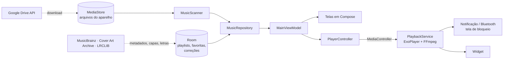

<div align="center">


# MusicFree

**Player de música offline para Android: toca os arquivos do seu celular, sem conta, sem anúncio e sem streaming.**


</div>

---

## Visão geral

O **MusicFree** é um player para quem tem a própria coleção de músicas em arquivo: MP3, FLAC, M4A, OGG, Opus, WMA, APE e outros. Ele lê a biblioteca do aparelho e organiza tudo em álbuns, artistas, pastas, playlists e favoritas. Também toca em segundo plano, com notificação, tela de bloqueio e widget.

Além do básico, o app:
- importa músicas de uma pasta do **Google Drive**;
- corrige nomes genéricos ("Faixa 1", "01 - artista_musica (official video)");
- baixa **capas e letras sincronizadas** da internet.

Essas correções ficam só no banco do app, sem alterar os arquivos.

Tudo roda no próprio celular. Não há servidor, conta de usuário nem coleta de dados. A internet só é usada quando você pede uma importação do Drive ou uma correção de metadados.

## Recursos

| | |
|---|---|
| 🎵 **Formatos** | Decoders nativos do Android, com o **FFmpeg** como reserva para o que o ExoPlayer não toca sozinho (WMA, APE, ALAC, AC3, DTS…). Arquivos com defeito são pulados automaticamente. |
| 🔁 **Reprodução** | Loop da playlist inteira, repetir uma música, aleatório, fila editável (arrastar para reordenar, tocar a seguir, remover), velocidade de 0,5× a 2× e timer para dormir. |
| 📚 **Biblioteca** | Início com atalhos e carrosséis, busca por título/artista/álbum, filtros (Músicas, Playlists, Álbuns, Artistas, Favoritas, Mais tocadas, Recentes, Ocultas), navegação por pasta, ordenação e ocultar faixas curtas. |
| 📝 **Playlists** | Criar, reordenar arrastando, capa em mosaico, loop da playlist, importar e exportar **.m3u**. |
| 🎚️ **Equalizador** | Bandas do equalizador do sistema e reforço de volume (*loudness*) para faixas gravadas baixo. |
| 🎤 **Letras** | Letras sincronizadas (.lrc) que acompanham a música, importadas por arquivo, por pasta ou baixadas automaticamente. |
| ☁️ **Google Drive** | Cola o link de uma pasta compartilhada e o app baixa todos os áudios (inclusive subpastas) para `Música/MusicFree`, pulando o que já existe. |
| 🪄 **Correção automática** | Identifica título, artista e álbum (MusicBrainz), baixa capas (Cover Art Archive) e letras (LRCLIB). Tudo reversível com um toque. |
| 🎨 **Visual** | Tema escuro/claro/sistema, Material You opcional, cor da marca em violeta, fundo do player e das telas de álbum com a cor da capa. |
| 📱 **Integração** | Notificação de mídia, controles na tela de bloqueio e Bluetooth, widget na tela inicial e pausa automática ao desconectar o fone. |

## Como funciona



A reprodução fica num `MediaSessionService` (Media3), então continua tocando com o app fechado. A interface conversa com ele por um `MediaController`. As correções de nome e capa são uma "camada" do Room aplicada por cima do que vem do MediaStore. Por isso desfazer é só apagar essa camada.

## Privacidade

| Dado | O que acontece |
|---|---|
| **Suas músicas** | São lidas do armazenamento do aparelho e nunca saem dele. |
| **Playlists, favoritas, estatísticas** | Ficam no banco local do app (Room). Não há conta nem sincronização. |
| **Chave da API do Google** | Fica salva só no celular (DataStore). Não vai para o código nem para o repositório. |
| **Correção de metadados** | Envia apenas título, artista e duração para MusicBrainz e LRCLIB, sem nenhum identificador seu. Só roda quando você toca no botão. |
| **Arquivos de áudio** | Nunca são modificados pela correção automática. A edição manual de informações altera só a biblioteca do Android, e apenas com a sua permissão. |

## Build e instalação

**Requisitos:** JDK 17 e Gradle 8.7, ou o Android Studio. O celular precisa ter **Android 13 ou superior**.

1. **Compilar**
   ```bash
   # com o Gradle 8.7 instalado e JAVA_HOME apontando para o JDK 17
   gradle :app:assembleDebug
   ```
   O APK sai em `app/build/outputs/apk/debug/app-debug.apk`. O Android SDK (Platform 35) é baixado automaticamente se a licença já estiver aceita.

2. **Instalar no celular**
   - **Por cabo:** ative a *Depuração USB* e rode `adb install -r app/build/outputs/apk/debug/app-debug.apk`. O `-r` atualiza por cima e mantém os dados.
   - **Sem cabo:** envie o APK para o celular (Drive, WhatsApp…) e abra, permitindo "instalar de fontes desconhecidas".

3. **Importar do Google Drive (opcional)**
   1. No [Google Cloud Console](https://console.cloud.google.com), crie um projeto e ative a **Google Drive API**.
   2. Em **Credenciais → Criar credenciais → Chave de API**, gere a chave. Se quiser, restrinja-a só à Drive API.
   3. Compartilhe a pasta de músicas no Drive como **"Qualquer pessoa com o link"**.
   4. No app, abra **Ajustes → Importar do Google Drive**, cole a chave e o link e toque em **Baixar músicas**.

> Atualizar por cima de uma versão antiga só funciona se o APK for assinado com a mesma chave. Se o Android recusar a atualização, a alternativa é desinstalar, mas isso apaga playlists e favoritas.

## Estrutura

```
Musicfree/
├── app/src/main/java/com/musicfree/player/
│   ├── data/            # MediaStore, Room (playlists, favoritas, correções), DataStore,
│   │                    # letras (.lrc), importação do Drive e correção de metadados
│   ├── playback/        # PlaybackService (ExoPlayer + FFmpeg, equalizador) e PlayerController
│   ├── ui/
│   │   ├── home/        # Tela Início
│   │   ├── search/      # Tela Buscar
│   │   ├── library/     # Biblioteca e telas de álbum/artista/pasta
│   │   ├── playlists/   # Playlists e detalhe com reordenação
│   │   ├── player/      # Player em tela cheia, mini player, fila e letras
│   │   ├── settings/    # Ajustes: tema, equalizador, letras, Drive, correções
│   │   ├── common/      # Componentes compartilhados (capas, cabeçalhos, itens de lista)
│   │   ├── navigation/  # Navegação e barra inferior
│   │   └── theme/       # Cores da marca e tipografia
│   ├── widget/          # Widget da tela inicial (Glance)
│   ├── MainActivity.kt
│   └── MainViewModel.kt
├── app/src/main/res/    # Ícone, drawables do widget, configuração do widget
└── docs/                # Imagens do README
```

## Limitações

- Músicas sem nenhuma pista (sem tag, com nome como "Faixa 1" e sem nome de pasta útil) **não são identificadas**. Isso exigiria reconhecimento pelo som (impressão digital do áudio), que o app ainda não tem.
- A importação do Drive roda com o app aberto. Se o Android encerrar o app no meio, basta rodar de novo, porque o que já foi baixado é pulado.
- A edição manual de informações muda só a biblioteca do Android, não as tags dentro do arquivo.
- O equalizador depende do aparelho. Alguns fabricantes não oferecem os efeitos de áudio do sistema.
- Sem testes automatizados, e o repositório ainda não tem o script `gradlew`.

## Ideias para o futuro

- [ ] Reconhecimento de músicas pelo som (Chromaprint/AcoustID) para as faixas sem nome
- [ ] Download do Drive em segundo plano, com notificação de progresso
- [ ] Tela de revisão "antes/depois" para as correções automáticas
- [ ] Gravar as correções também nas tags dos arquivos (opcional)
- [ ] Adicionar o Gradle Wrapper (`gradlew`) e testes automatizados

---

<div align="center">
MusicFree: suas músicas, no seu celular, do seu jeito.
</div>
